<div align="center">

<br/>

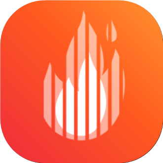

# FireTheDJ

### Your AI DJ for every party

<br/>

[](https://github.com/suryablaze02-byte/FireTheDJ/releases)
[](LICENSE)
[](https://github.com/suryablaze02-byte/FireTheDJ/releases)
[](#download)

<br/>

[**Features**](#features) · [**Screenshots**](#screenshots) · [**Download**](#download) · [**Install**](docs/INSTALL.md) · [**Build**](#build) · [**Contributing**](#contributing) · [**Support**](#support) · [**Disclaimer**](#disclaimer)

</div>

> [!IMPORTANT]
> FireTheDJ is an independent project. It is **not** affiliated with, endorsed by, or connected to YouTube, Google, TCL, Audius, Jamendo or the Internet Archive in any way. Use it at your own discretion.

<div align="center">
<br/>
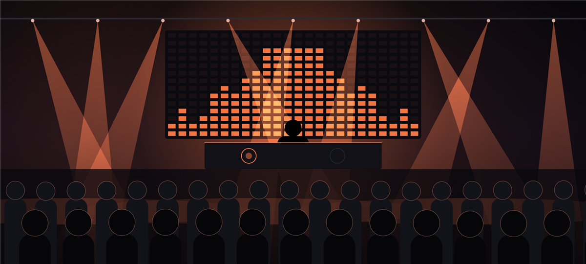
</div>

---

FireTheDJ mixes music the way a DJ does, on its own. It listens to every track (tempo, beat grid,
key, phrases, drops, vocals, energy), sorts them into genre crates, and then plays a continuous
set: it picks what comes next, finds the right bar to leave the current track and the right bar
to bring the next one in, matches tempo and key, and performs the transition with real effects:
bass swaps, echo-outs, filter sweeps, loop rolls, backspins, scratches, vocal swaps. There is no
"mix now" button. The AI is the DJ.

<h2 id="features">Features</h2>

<table>
  <tr>
    <td width="50%" valign="top">

#### The DJ
- **Hands-free sets** from one genre crate or **all genres**; a different route through the same music every time.
- **Beat-matched transitions**: phrase-aligned exits and entries, tempo glide, key matching on the Camelot wheel (±2 semitones, key-locked).
- **11 transition recipes**: bass-swap, phaser and flanger blends, filter and lo-fi fades, echo-out, gate build & drop, backspin, scratch cut, vocal swap, loop & ramp.
- **Performs inside a track**: tempo pushes, loop-roll builds into drops, hook replays.
- **Smooth or Trickster mode**: clean blends, or scratches, brakes, echo throws, sirens and air horns all through the set.
- **Songs join the set live**: tracks that finish analysing while a set plays are queued into it if they belong to the crate you picked.

#### Music sources
- **Your phone**: whole folders, rescanned on every launch.
- **YT Music**: browse YouTube Music's curated playlists by mood and genre, or paste any playlist or album link. Tracks stream; nothing is saved.
- **Audius, Jamendo, Internet Archive, M3U** links and direct audio links.

    </td>
    <td width="50%" valign="top">

#### Understanding the music
- **On-device analysis**: tempo to 0.01 BPM, beat phase, downbeats, 8-bar phrases, intro/outro, breakdowns, drops, hook, vocal bars, tempo changes.
- **Genre crates** detected from the audio, fused with tags and an online lookup.
- **Key detection** shown in Camelot notation.

#### Show & sound
- **5 visualizers**: Club, Haze & Beams, Neon Tunnel, Liquid Light, LED Field. Full screen, portrait or landscape.
- **Live mixing view**: both decks, crossfader, rate, phase error, key and every effect as it happens.
- **Cast to a TV**: Miracast / Smart View screens show the visualizer in landscape; Chromecast & Google TV get the live mix ([how](docs/CASTING.md)).
- **Android Auto**: pick a crate in the car and the set starts.
- **FireTheDJ TV**: a separate Android TV app, run from the remote. The visualizers take over the screen and change look every 30 seconds; ◀ ▶ switches looks, OK brings up Home, Play/Pause and Stop.
- **Background play** with media controls, audio focus and headphone-unplug pause.
- **Guided tour** on first launch, on phone and TV.
- **Updates itself**: Settings shows new releases and what's new, and installs them.
- **A frosted-glass look** on phone and TV.

    </td>
  </tr>
</table>

<h2 id="screenshots">Screenshots</h2>

<div align="center">
<table>
  <tr>
    <td align="center">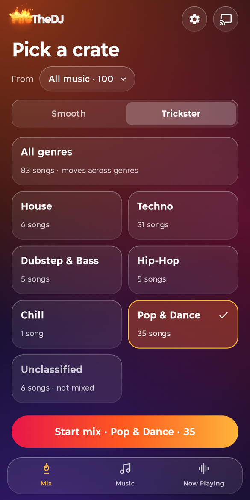<br/><sub>Mix: pick a crate</sub></td>
    <td align="center">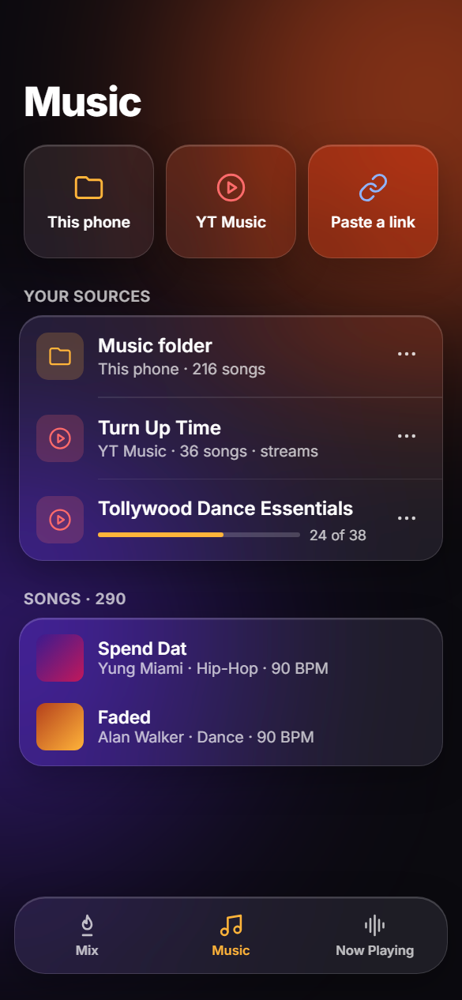<br/><sub>Music: your sources</sub></td>
    <td align="center">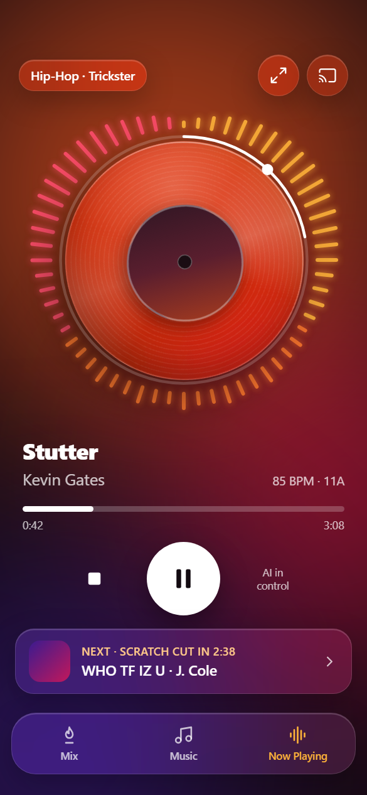<br/><sub>Now Playing</sub></td>
  </tr>
  <tr>
    <td align="center">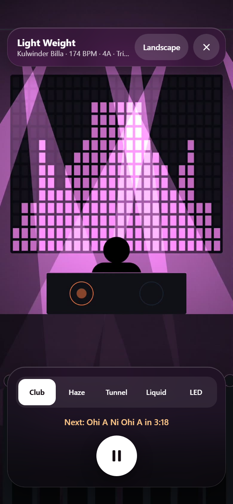<br/><sub>Full-screen visualizers</sub></td>
    <td align="center">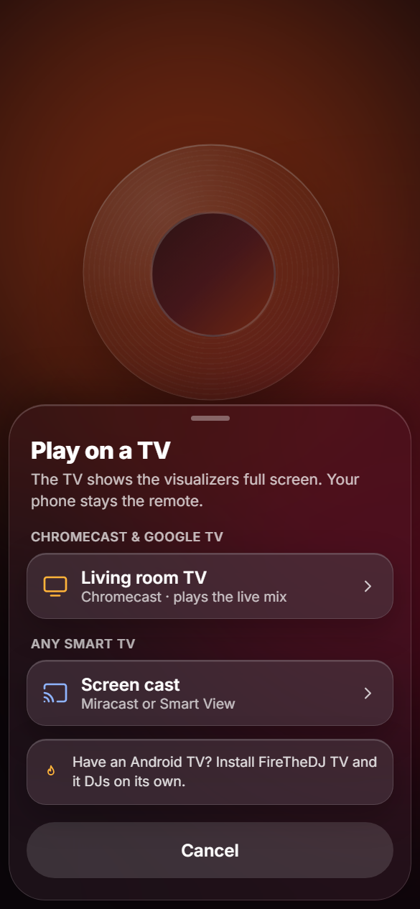<br/><sub>Play on a TV</sub></td>
    <td align="center">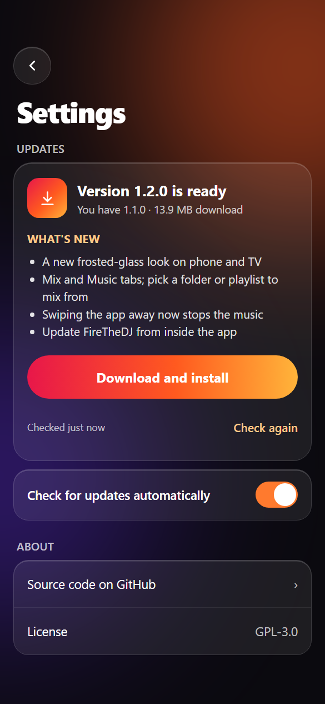<br/><sub>Settings &amp; updates</sub></td>
  </tr>
  <tr>
    <td align="center">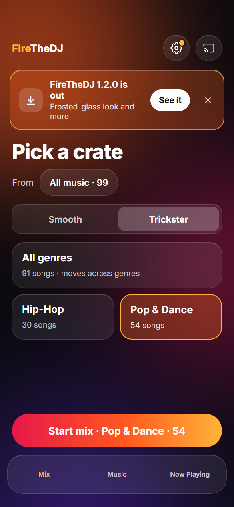<br/><sub>A new version is out</sub></td>
    <td align="center">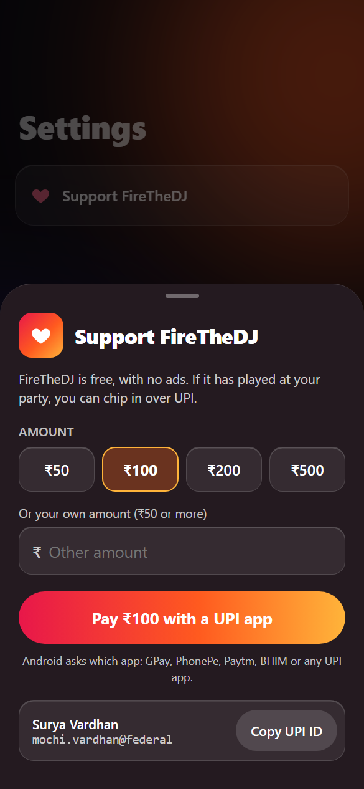<br/><sub>Support over UPI</sub></td>
    <td></td>
  </tr>
</table>
</div>

#### FireTheDJ TV

<div align="center">
<table>
  <tr>
    <td align="center">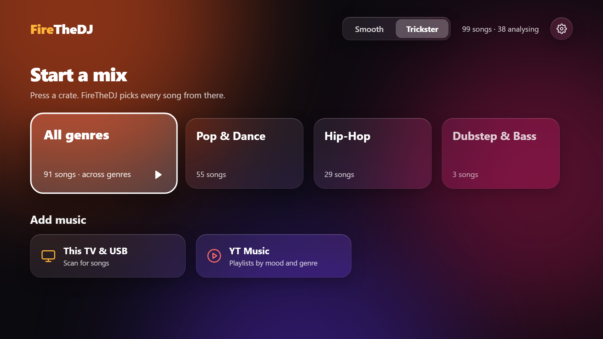<br/><sub>Home: mode, crates and music sources</sub></td>
    <td align="center">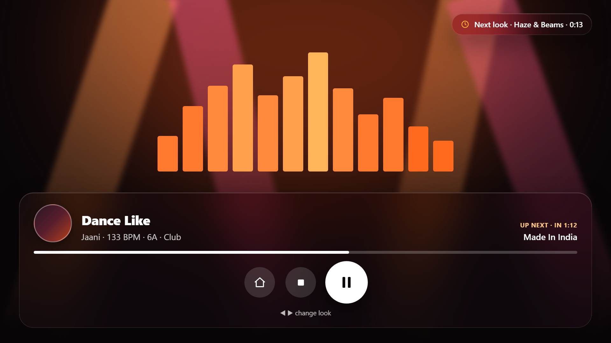<br/><sub>Home, Stop and Play/Pause on OK</sub></td>
  </tr>
  <tr>
    <td align="center">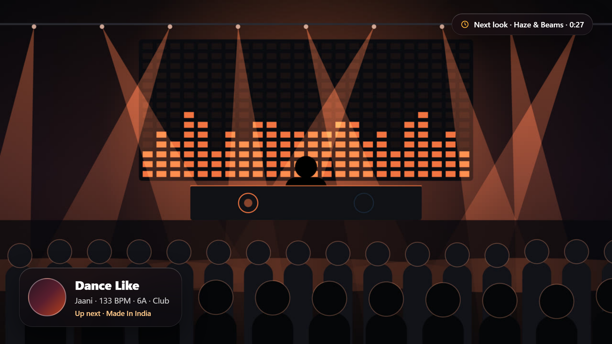<br/><sub>Full-screen visualizers, a new look every 30 s</sub></td>
    <td align="center">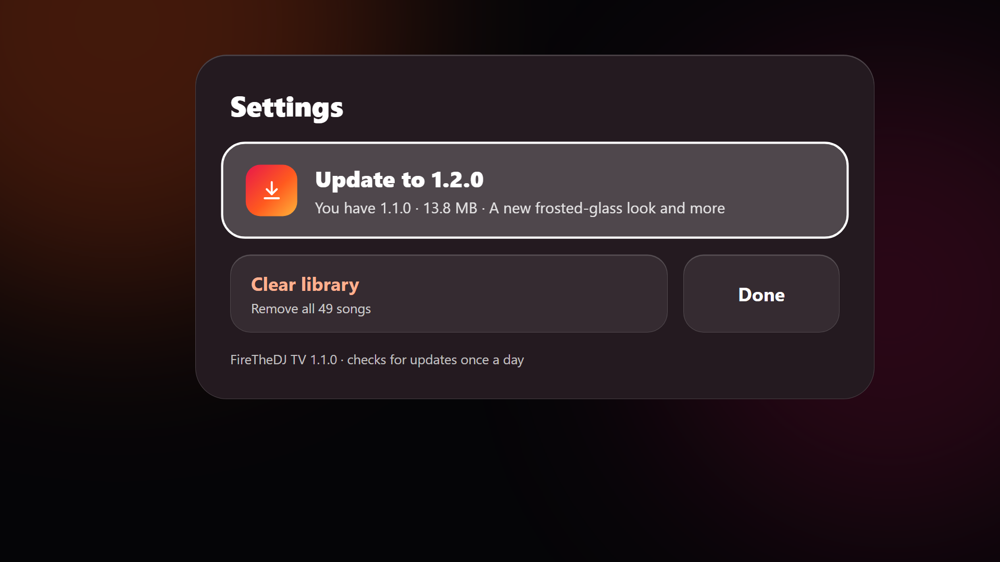<br/><sub>Settings: updates, support, clear library</sub></td>
  </tr>
</table>
</div>

<h2 id="download">Download</h2>

Grab the latest APK from the [**Releases**](https://github.com/suryablaze02-byte/FireTheDJ/releases) page. Step-by-step help for phones and TVs, first launch and troubleshooting: [**Installation Guide**](docs/INSTALL.md). Sideloading needs "Install unknown apps" allowed for the app you open it with. From 1.2.0 on, FireTheDJ tells you when a new version is out and installs it from **Settings**.

| App | For |
|---|---|
| **FireTheDJ** | Android phones and tablets |
| **FireTheDJ TV** | Android TV and Google TV: shows up in the TV's app drawer, runs from the remote, and plays the visualizers full screen, rotating through all five while the mix plays. Add music from the TV's storage or a USB drive, or YT Music playlists. To install, copy the APK to the TV (USB drive, or an app like *Send Files to TV*) and open it with a file manager. |

| Needs | |
|---|---|
| Android 8.0+ | the apps |
| Android 10+ | casting the mix to a Chromecast |
| Android 13+ | YouTube Music streaming |

<h2 id="build">Build</h2>

Requires JDK 17 and the Android SDK (platform 34).

```bash
./gradlew testPhoneDebugUnitTest assemblePhoneDebug assembleTvDebug
```

The phone and TV APKs land in `app/build/outputs/apk/phone/debug/` and `app/build/outputs/apk/tv/debug/`. Both apps share all the DJ code; the TV app's screens are in `app/src/tv`. Optional settings go in `local.properties`:

```properties
jamendo.clientId=…   # free at devportal.jamendo.com, for Jamendo links
cast.appId=…         # your Google Cast receiver, for visualizers on a Chromecast (docs/CASTING.md)
```

Release builds and signing: [docs/RELEASE_SIGNING.md](docs/RELEASE_SIGNING.md). How the DJ works inside, recipe by recipe and effect by effect: [docs/HOW_IT_WORKS.md](docs/HOW_IT_WORKS.md).

<h2 id="contributing">Contributing</h2>

Contributions are welcome: bug reports, ideas, new transition recipes, visualizers, translations. Please read the [Contributing Guide](CONTRIBUTING.md) and the [Code of Conduct](CODE_OF_CONDUCT.md) before opening a pull request.

<div align="center">

<h2 id="support">Support</h2>

FireTheDJ is free and always will be. If it has played at your party, you can chip in over UPI, here or from **Settings › Support FireTheDJ** in the app:

<br/>

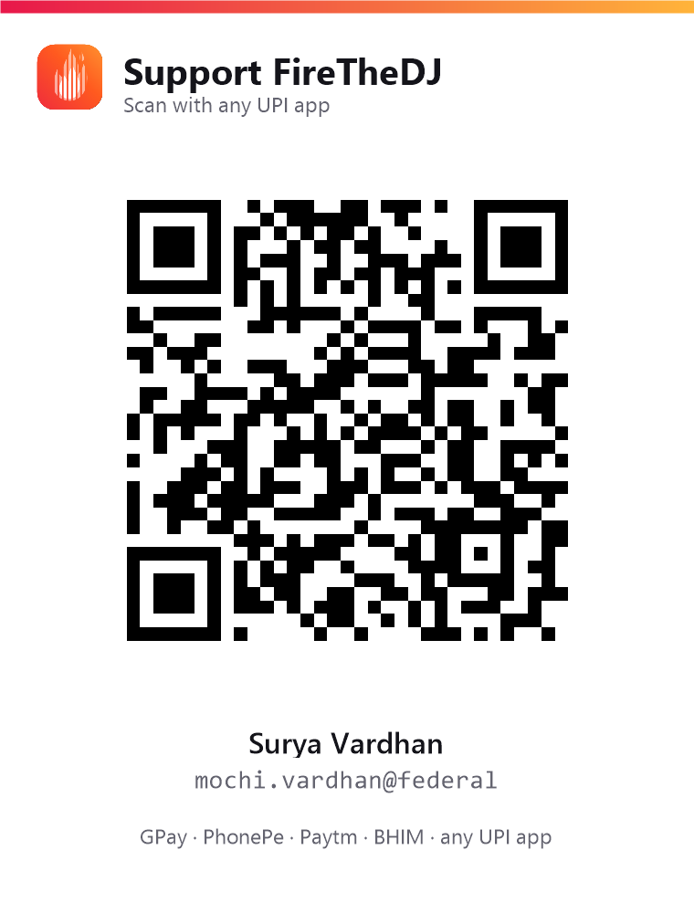

<sub>UPI ID: <code>mochi.vardhan@federal</code> · Surya Vardhan</sub>

</div>

<h2 id="disclaimer">Disclaimer &amp; legal notice</h2>

FireTheDJ is an independent, community-driven music player and automatic mixer. It is **not** associated with Google LLC, YouTube, YouTube Music, TCL, Audius, Jamendo, the Internet Archive, or any of their parent companies.

* **No media hosting.** FireTheDJ does not host, upload or store copyrighted music. It plays files already on your device, or streams from public, public-facing or user-provided sources at the time you play them. Streamed YouTube tracks are never saved; tracks from other services are only kept where that service allows downloads.
* **Your responsibility.** FireTheDJ is made for personal, non-commercial and educational use. You are responsible for making sure your use, including streaming, mixing, and playing music in public or at events, complies with the copyright laws where you are and with the terms of service of every service you use (including YouTube's). Playing music at a public event may need a public performance licence.
* **Unofficial interfaces.** YouTube and YouTube Music support relies on unofficial interfaces ([NewPipeExtractor](https://github.com/TeamNewPipe/NewPipeExtractor) and YouTube Music's web API). They can stop working at any time, and their use may not be permitted by those services' terms.
* **No guarantees.** FireTheDJ is provided "as is", without warranty of any kind (see the licence). Genre, key and beat analysis are automatic estimates and can be wrong.
* **Trademarks.** YouTube, YouTube Music, Google Cast, Chromecast, Google TV, Android and Android Auto are trademarks of Google LLC; Miracast is a trademark of the Wi-Fi Alliance; other names belong to their owners. They are used here only to describe compatibility.
* **Copyleft.** FireTheDJ is free software under the GPLv3. You may sell or redistribute copies, but any distribution must include the corresponding source under the same licence.

<h2 id="license">License</h2>

FireTheDJ is licensed under the **GNU General Public License v3.0**. See [LICENSE](LICENSE).

It builds on open-source work, including [NewPipeExtractor](https://github.com/TeamNewPipe/NewPipeExtractor) (GPLv3) for YouTube streams, [AndroidX Media3 / ExoPlayer](https://github.com/androidx/media) and [Jetpack Compose](https://developer.android.com/jetpack/compose) (Apache 2.0). Cover art lookups use the iTunes Search API.

<div align="center">
<br/>
<sub>Made with passion ❤️ by Surya</sub>
</div>
